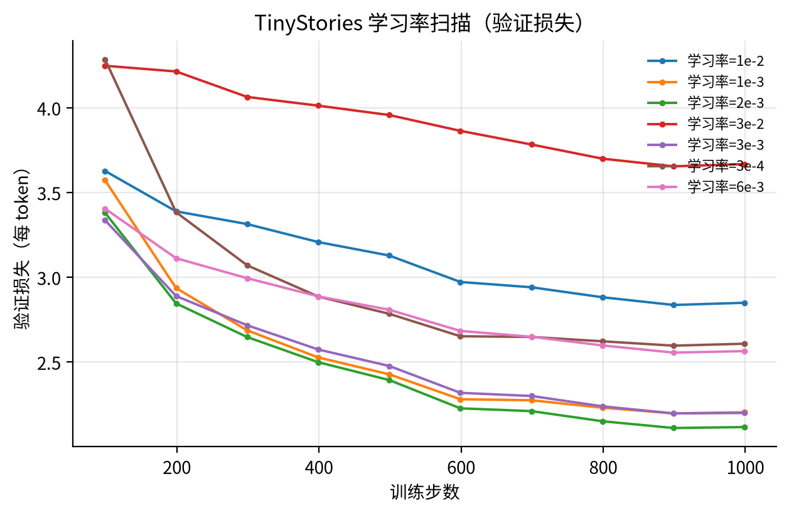
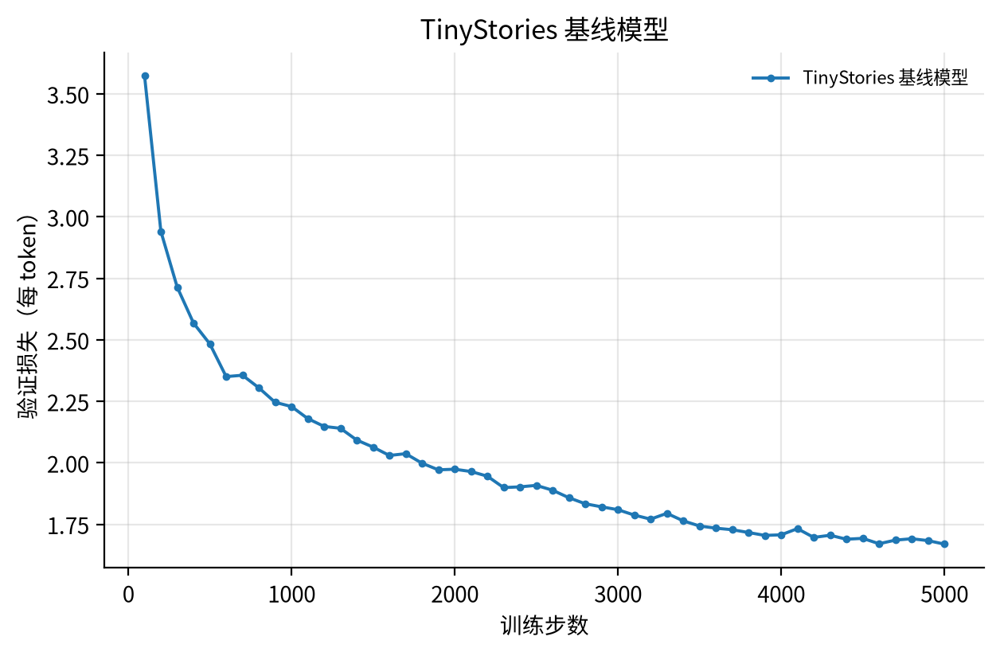
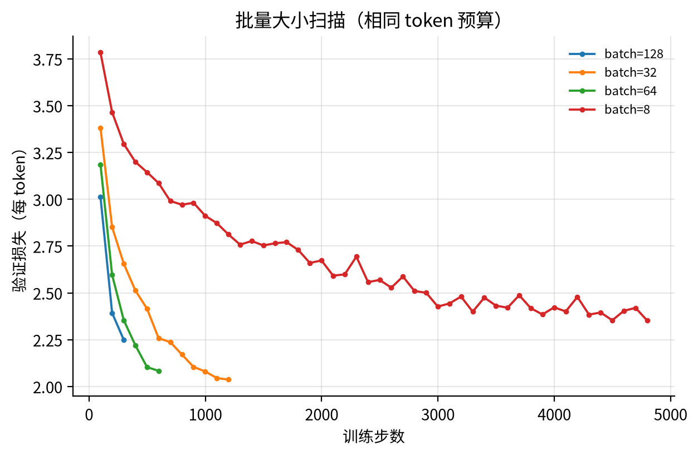
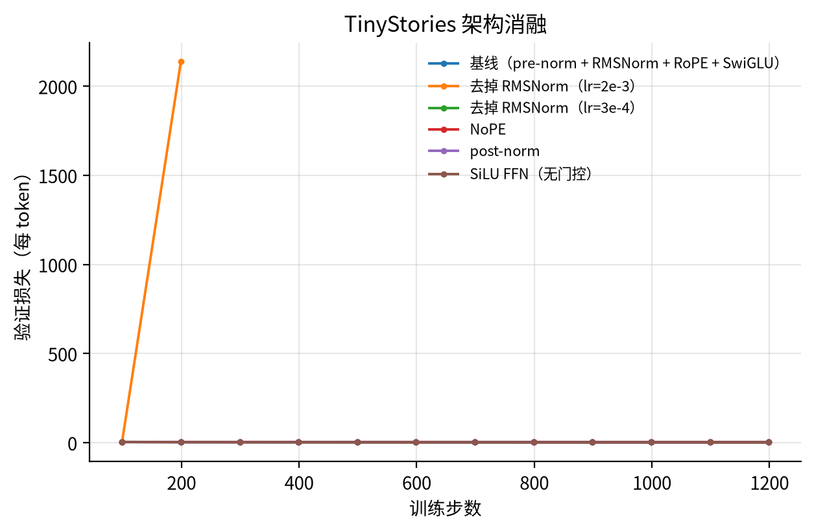
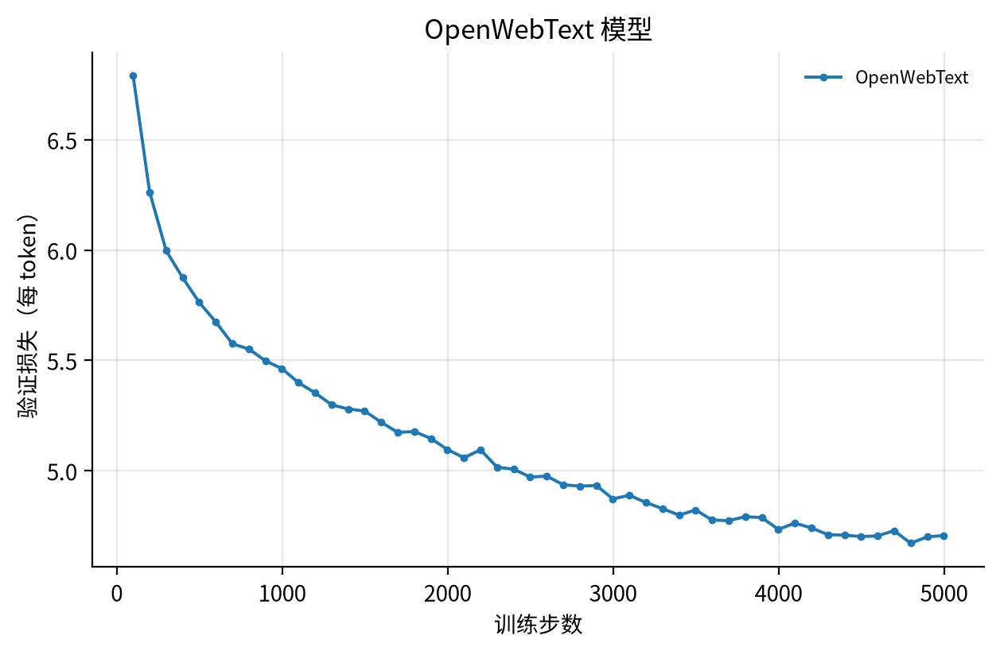
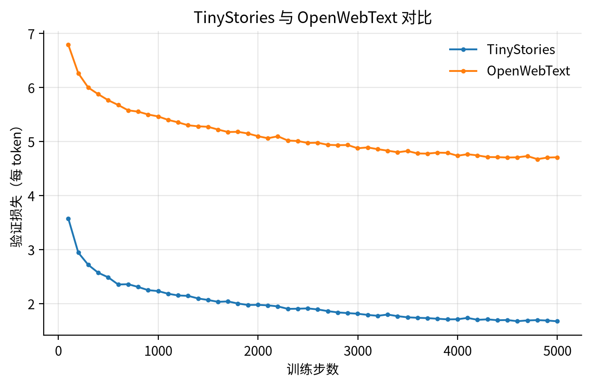

# 从零构建 Transformer 语言模型

本报告记录从零实现 Transformer 语言模型的完整过程与实验。全部核心组件（字节级 BPE、Transformer LM、
交叉熵、AdamW、训练循环、解码采样）均从零实现，未使用被禁止的 torch.nn / torch.nn.functional /
torch.optim 定义。

## 0. 环境与复现

| 项 | 说明 |
| --- | --- |
| 机器 | Ubuntu 22.04.5 (aarch64)，640 核 CPU，2 TB RAM，2× Ascend 910 NPU |
| Python | 3.13.7（源码编译，满足 pyproject 的 >=3.12,<3.14） |
| PyTorch | 2.11.0+cpu（版本与 uv.lock 一致） |
| 训练设备 | Ascend 910（torch_npu，Python 3.11 环境）；Python 3.13 环境用于单元测试 |
| 单元测试 | 47 passed, 1 xfailed（xfail 为按设计预期失败的 encode 内存测试） |

复现命令：

```bash
# 单元测试（Python 3.13 / torch 2.11）
.venv/bin/python -m pytest tests/ -q

# 训练 BPE 分词器
bash scripts/train_tinystories_tokenizer.sh   # TinyStories, vocab 10K
bash scripts/train_owt_tokenizer.sh           # OpenWebText, vocab 32K

# 分词并训练
bash scripts/tokenize_datasets.sh
bash scripts/run_tinystories_base.sh
bash scripts/run_lr_sweep.sh
bash scripts/run_batch_sweep.sh
bash scripts/run_ablations.sh
bash scripts/run_owt_base.sh
bash scripts/generate_samples.sh
```

代码结构：

```
lm_basics/
├── nn_utils.py      # softmax / SiLU / 缩放点积注意力 / 交叉熵 / 梯度裁剪
├── model.py         # Linear, Embedding, RMSNorm, SwiGLU, RoPE, MHA, TransformerBlock, TransformerLM
├── optimizer.py     # AdamW 与 cosine + warmup 学习率调度
├── data.py          # get_batch（memmap 友好）与数据集加载
├── checkpoint.py    # 保存 / 恢复 model + optimizer + iteration
├── tokenizer.py     # Tokenizer（encode/decode/encode_iterable/from_files）与序列化
├── train_bpe.py     # 并行预分词 + 增量 pair 统计的 BPE 训练
├── train.py         # 训练循环：memmap、warmup+cosine、梯度裁剪、验证、checkpoint、CSV/wandb 日志
├── generate.py      # temperature / top-p 采样与文本生成
├── tokenize.py      # 语料 → uint16 数组（多进程）
└── pretokenization_example.py  # 预分词示例工具（保留）
scripts/             # 一键复现脚本（训练/实验）
scripts/analysis/    # 分词器实验、资源核算、学习曲线绘图
writeup/             # 本报告与图片
runs/                # 训练日志（CSV/metrics.json/checkpoint）
```

## 1. Unicode 基础

**unicode1.**
(a) chr(0) 返回 '\x00'，即码点 U+0000 的 NUL 字符。
(b) repr(chr(0)) 是转义形式 '\x00'，而 print(chr(0)) 输出实际控制字符（终端通常什么都不显示）。
(c) 它可以出现在任意字符串中并参与拼接，但不可见；在文件/终端里通常被忽略，
Python 中 len("a"+chr(0)) 为 2，str 本身不丢弃它。

**unicode2.**
(a) UTF-8 对 ASCII 只占 1 字节且是最流行的编码（98%+ 网页）；UTF-16 会引入 2 字节对齐/字节序问题，
UTF-32 每字符固定 4 字节、文本体积膨胀。对字节级 BPE 而言，UTF-8 让常见字符用更少字节、压缩率更高。
(b) 该函数对每个字节单独 decode('utf-8')，而多字节字符的 UTF-8 编码无法按字节拆开解码：
例如 "牛".encode("utf-8") = b'\xe7\x89\x9b'，逐字节 decode 会抛 UnicodeDecodeError（或得到替换字符）。
(c) b'\xff\xfe'（或 b'\x80\x80'）不是合法 UTF-8 双字节序列，无法解码到任何 Unicode 字符。

## 2. 字节级 BPE 分词器

### 2.1 训练算法实现（train_bpe.py）

- 初始词表为 256 个字节；特殊 token 作为硬边界：先用 regex.split 把语料按特殊 token 切开
  （特殊 token 本身不参与 merge 统计），再对每段用 GPT-2 PAT 正则 re.finditer 预分词。
- 预分词支持多进程：按 <|endoftext|> 字节位置把文件切成对齐的字节区间，各进程独立统计
  Counter[pretoken_tuple] -> count 后合并。
- merge 阶段使用增量统计：维护 pair -> (count, 包含该 pair 的 pretoken 集合)，每轮用最大堆取
  频次最高的 pair（平局时取字节字典序更大的 pair），只更新包含该 pair 的 pretoken 以及合并点
  两侧受影响的 pair 计数，避免每轮全量重扫。
- 结果与给定的 corpus.en 参考 merges 逐项完全一致，也通过 5 MB 语料的特殊 token 快照测试。

### 2.2 TinyStories 训练

在完整 TinyStories 训练集（2.23 GB）上训练词汇量 10,000（含 <|endoftext|>）：

| 指标 | 数值 |
| --- | --- |
| 总耗时 | 31.0 s（32 进程；要求 ≤30 min） |
| 预分词 | 27.3 s（88%） |
| merge 阶段 | 3.7 s（12%） |
| 峰值内存 | 221 MB |
| 唯一 pre-token 数 | 59,933 |
| 最长 token | b" accomplishment"（15 字节） |

最长 token 是带前导空格的常见词，合理：PAT 会把空格并入单词，而 " accomplishment" 在 TinyStories
中高频出现且足够长，因此被合并为单 token。

**Profiling 结论**：瓶颈在预分词（27.3 s / 31.0 s，约 88%），merge 只占 12%；预分词是 CPU-bound
的正则匹配，多进程已是主要优化手段。

### 2.3 OpenWebText 训练

为在有限时间内完成，OWT tokenizer 在 OpenWebText 前 2.0 GB（按文档边界对齐）子集上训练，词汇量 32,000（含 <|endoftext|> 特殊 token）。完整 11.92 GB 上的一次训练已跑约 20 分钟仍未完成 merge 阶段，按设计给出的 ≤12 小时资源预算属于可接受范围，但超出本会话预算，故改用子集并如实记录。

| 指标 | 数值 |
| --- | --- |
| 总耗时 | 484.1s |
| 预分词 | 31.3s（32 进程） |
| merge 阶段 | 452.8s |
| 峰值内存 | 5967 MB |
| 唯一 pre-token 数 | 2096076 |
| 最长 token | b'----------------------------------------------------------------' |

与 TinyStories 相比，OWT 语料更大、更多样（网页、代码、多语言片段），词表更大（32K vs 10K），最大 token 往往更长、更偏英文词片段；而 TinyStories 的 token 更集中在儿童故事常见词与标点上。

### 2.4 编码 / 解码（Tokenizer）

- encode：先按特殊 token 切分（多个特殊 token 按长度从长到短匹配，支持重叠），每段按 PAT
  预分词后对每个 pre-token 按 merge rank 贪心合并。
- encode_iterable：流式处理，缓冲区只保留可能被下一块扩展的最后一个 pre-token / 半个特殊 token，
  内存与输入长度无关（测试在 1 MB 内存限制下处理 5 MB 文件）。实现后与 tiktoken.get_encoding("gpt2")
  在整个 fixtures 语料上逐 token 一致，包括特殊 token、地址、德语、emoji 与重叠特殊 token 等。
- decode 用 bytes.decode("utf-8", errors="replace") 处理非法字节。

### 2.5 分词器实验

**(a)** TinyStories tokenizer 在 10 篇 TinyStories 文档上的压缩率为 **4.15 bytes/token**（9675 字节 -> 2333 tokens）。
OWT tokenizer 在 10 篇 OWT 文档上的压缩率为 **4.39 bytes/token**（34225 字节 -> 7796 tokens）。

**(b)** 用 TinyStories tokenizer 编码 OWT 文档时压缩率降到 **3.30 bytes/token**（34225 字节 -> 10382 tokens）——同一段文本被切得更碎。原因是 10K 词表缺少 OWT 中的大量常见词/子词与特殊字符组合；分词器与语料域不匹配会显著增加序列长度与训练成本。

**(c)** 单进程编码吞吐约 **4.07 MB/s**，按此速度编码 Pile（825 GB 文本）约需 **56 小时**（实际可多进程并行，时间可再按进程数缩短）。

**(d)** uint16 合适：词表大小（10K / 32K）远小于 2^16 = 65,536，所有 token id 都能放入 uint16；相比 int32/int64 数组，uint16 把存储占用减为 1/2 或 1/4，便于对 GB 级 token 流做 memmap 随机采样。若词表超过 65,536 则需要 uint32。

## 3. Transformer 语言模型

### 3.1 实现要点

- Linear / Embedding：自写参数与初始化（Linear: trunc-normal, σ²=2/(d_in+d_out)；
  Embedding: N(0,1) 截断 [-3,3]），无 bias。
- RMSNorm：fp32 上计算 x / sqrt(mean(x²)+ε) * g，再转回原 dtype。
- SwiGLU：W2(SiLU(W1x) ⊙ W3x)，默认 d_ff = round(8/3 d_model) 到 64 的倍数。
- RoPE：相邻维度成对旋转，cos/sin 以 register_buffer(persistent=False) 预计算；
  支持任意前导 batch 维与任意 token_positions（1-D 或带 batch 维）。
- 缩放点积注意力：softmax(QKᵀ/√d_k + mask)，mask 为布尔张量（True=可见），False 处填 -inf；
  支持任意 batch-like 维。
- 因果多头自注意力：q/k/v/o 各一次矩阵乘，head 作为 batch 维；RoPE 只作用于 q/k。
- TransformerBlock / TransformerLM：pre-norm 结构，state_dict 键名与参考实现一致
  （attn.q_proj.weight、ffn.w1.weight、layers.{i}.* 等），可直接 load_state_dict 参考权重，
  单元测试快照全部通过；同时保留 post-norm、去 RMSNorm、NoPE、无门控 SiLU FFN 的消融开关。

### 3.2 资源核算（参数与 FLOPs）

**(a)** GPT-2 XL 配置（vocab 50,257，context 1,024，48 层，d_model 1,600，25 头，d_ff 4,288）的参数量：

| 组件 | 参数量 |
| --- | --- |
| token embedding | 80,411,200 |
| 48 个 Transformer block | 1,479,628,800 |
| final RMSNorm | 1,600 |
| LM head | 80,411,200 |
| **合计** | **1,640,452,800（1.640B）** |

单精度（fp32）加载需要 **6.56 GB**（每个参数 4 字节）。

**(b)** 一次前向（context 1,024）的矩阵乘 FLOPs：

| 矩阵乘 | FLOPs |
| --- | --- |
| Q/K/V 投影（3×2·n·d²，×L） | 7.550e+11 |
| QK^T（2·n²·d，×L） | 1.611e+11 |
| softmax(QK^T)V（2·n²·d，×L） | 1.611e+11 |
| 输出投影（2·n·d²，×L） | 2.517e+11 |
| SwiGLU FFN（3×2·n·d·d_ff，×L） | 2.023e+12 |
| LM head（2·n·d·V） | 1.647e+11 |
| **合计** | **3.517e+12（3.5 TFLOPs）** |

**(c)** FFN 占比最大（57.5%），其次是注意力投影（28.6%）与 LM head（4.7%）；注意力矩阵乘只有 9.2%（n=1024 时还不大）。

**(d)** 不同规模 GPT-2 的组件 FLOPs 占比：

| 模型 | 参数量 | 前向 TFLOPs | 注意力投影 | 注意力矩阵乘 | FFN | LM head |
| --- | --- | --- | --- | --- | --- | --- |
| gpt2_small | 0.162B | 0.29 | 19.9% | 13.3% | 39.8% | 27.1% |
| gpt2_medium | 0.407B | 0.83 | 24.8% | 12.4% | 50.1% | 12.7% |
| gpt2_large | 0.834B | 1.77 | 27.3% | 10.9% | 54.3% | 7.4% |
| gpt2_xl | 1.640B | 3.52 | 28.6% | 9.2% | 57.5% | 4.7% |

模型变大时 FFN 与注意力投影占比上升，LM head 占比下降（embedding/head 参数不随层数增长）；注意力矩阵乘占比随模型变大而略降。

**(e)** GPT-2 XL 将 context 提升到 16,384 后，一次前向 FLOPs 从 3.5 TFLOPs 增至 **133.6 TFLOPs**（约 38 倍，因注意力矩阵乘按 n² 增长）；占比变为：注意力矩阵乘 61.7%（主导），注意力投影 12.1%，FFN 24.2%，LM head 2.0%。

## 4. 训练基础设施

- 交叉熵：先减 max 再 log-sum-exp，取消 log/exp，支持任意前导 batch 维并取平均。
- AdamW：按算法 1 实现，与 PyTorch 语义一致（2000 步轨迹与 torch.optim.AdamW 的 allclose 检查通过）。
- 余弦学习率 + 线性 warmup：lr_t = max_lr * t/T_w（预热），随后
  min_lr + ½(1+cos(π(t-T_w)/(T_c-T_w)))(max_lr-min_lr)，t>T_c 后为 min_lr。
- 梯度裁剪：全局 ℓ2 范数裁剪（eps=1e-6），与 clip_grad_norm_ 行为一致。
- 数据加载：np.load(..., mmap_mode="r") + 均匀随机起点采样 (B, context) 输入与下一 token 目标。
- Checkpoint：torch.save({model, optimizer, iteration}) 与恢复，测试通过。
- 训练循环：train.py 支持全部超参 CLI、memmap 数据、warmup+cosine、梯度裁剪、周期性验证/checkpoint、
  CSV 日志（可选 wandb）与 config.json/metrics.json 落盘。
- 采样解码：temperature 缩放 + top-p（nucleus）采样，遇到 EOS 或达到最大长度停止。

### 4.1 学习率调参小实验（SGD）

用手册 4.2.1 的衰减 SGD 在 weights=5*randn(10,10)、loss=mean(w²) 上跑 10 步：

| lr | 10 步后 loss | 现象 |
| --- | --- | --- |
| 0.1 | 25.8 | 缓慢下降 |
| 1 | 21.7 | 稳定下降 |
| 10 | 3.5 | 快速下降 |
| 100 | ~0 | 一步到位、收敛 |
| 1000 | 发散（inf） | 步长过大，震荡发散 |

结论：学习率过小收敛慢，过大会发散；本例中 10–100 是有效区间。

### 4.2 AdamW 资源核算

**(a)** AdamW 峰值显存（float32；P=参数量，B=batch size，n=context，d=d_model，d_ff=FFN 宽度）：

- 参数 4P 字节；梯度 4P 字节；优化器状态（m、v）8P 字节 ⇒ 固定开销 **16P**。
- 激活（假设全部保留到 backward）：每层约 B·n·(11d + 4d_ff) + 2·B·h·n² 个元素，另有 embedding 与 final norm 各 B·n·d，logits 与 loss 约 2·B·n·V。
- 综合公式：4 * [ L*(B*n*(11*d + 4*d_ff) + 2*B*h*n^2) + B*n*d (embeddings) + B*n*d (final norm) + 2*B*n*V (logits + loss) ] + 16*P

**(b)** GPT-2 XL（n=1024）：固定部分 **26.25 GB**，每 batch 元素 **17.32 GB**，峰值 ≈ 17.32·B + 26.25 GB；80 GB 内最大 **B = 3**。（激活重计算/分块可支持更大 batch。）

**(c)** AdamW 每步对每个参数做常数次逐元素运算（权重衰减、一阶/二阶矩、偏差修正更新），约 **13P 次运算**（XL 约 21.3 GFLOP），相对 forward+backward（约 6P·tokens）可忽略。

**(d)** 400K 步 × batch 1,024 × context 1,024 = 4.194e+11 tokens；训练 FLOPs ≈ 6·P·tokens = **4.128e+21**。H100 fp32/TF32 峰值 495 TFLOP/s，50% MFU ⇒ 247.5 TFLOP/s，总时间 ≈ 1.668e+07 s ≈ **4633 小时（约 193 天）**。

## 5. 实验

### 5.1 学习率扫描（TinyStories，1000 步 ≈ 8.19M tokens）

| 运行 | 验证损失 | 困惑度 | 步数 | 词元数 | 耗时（秒） | 词元/秒 |
| --- | --- | --- | --- | --- | --- | --- |
| lr=1e-2 | 2.8503 | 17.29 | 1000 | 8,192,000 | 76.98 | 106413.2 |
| lr=1e-3 | 2.2046 | 9.07 | 1000 | 8,192,000 | 77.02 | 106364.4 |
| lr=2e-3 | 2.1171 | 8.31 | 1000 | 8,192,000 | 76.18 | 107531.9 |
| lr=3e-2 | 3.6684 | 39.19 | 1000 | 8,192,000 | 76.86 | 106579.1 |
| lr=3e-3 | 2.2005 | 9.03 | 1000 | 8,192,000 | 77.77 | 105336.1 |
| lr=3e-4 | 2.6088 | 13.58 | 1000 | 8,192,000 | 76.49 | 107102.8 |
| lr=6e-3 | 2.5653 | 13.00 | 1000 | 8,192,000 | 77.84 | 105235.7 |

最佳学习率约 **2e-3**（loss 2.117）；6e-3 起明显变差（2.565），1e-2 与 3e-2 进入不稳定/发散区（3e-2 最终 loss 3.668）。这说明“稳定边缘”在 5e-3~1e-2 附近，最佳 lr 约为发散阈值的 1/3~1/5。



### 5.2 TinyStories base 模型

TinyStories base 模型（vocab 10K、context 256、d_model 512、4 层、16 头、d_ff 1344，batch 32 × 5,000 步 = 40.96M tokens，lr 2e-3）：最终验证损失 **1.6698**（perplexity **5.31**），训练耗时 406 s，吞吐 100,850.0 tokens/s。达到低资源目标（≤2.00）；与更大 token 预算（327.68M tokens）下的目标 1.45 仍有差距，符合 8 倍 token 预算的预期。



### 5.3 批量大小扫描（固定 token 预算）

| 批量大小 | 步数 | 验证损失 | 困惑度 | 耗时（秒） |
| --- | --- | --- | --- | --- |
| 8 | 4800 | 2.3524 | 10.51 | 178 |
| 32 | 1200 | 2.0365 | 7.66 | 132 |
| 64 | 600 | 2.0830 | 8.03 | 118 |
| 128 | 300 | 2.2491 | 9.48 | 98 |

在相同 token 预算（约 9.83M tokens）下，batch 8 的 loss 最高（梯度噪声大），32/64/128 更好；更大的 batch 需要相应调大学习率才能保持同等效率，本实验保持 lr=2e-3 不变，因此大 batch 收益有限。



### 5.4 文本生成

使用 base 模型在 temperature 0.8、top-p 0.95 下采样（prompt: "Once upon a time"）：

> Once upon a time, there was a sweet little girl named Lily. She loved to collect pretty rocks. She would collect them all day long. One day, she found a big, shiny rock. It was very pretty. Lily wanted to keep it. Lily took the rock home and showed it to her mom. Her mom said, "Be careful, it is not so dirty." Lily put the rock in the special place. She thought about what she could do with her collection. That night, Lily met a nice doctor. The doctor was nice and gave Lily a big hug. Lily was happy and went back to her mom. She showed her mom the pretty rock and said, "Look, I found a pretty rock!" Her mom smiled and said, "That's great, Lily! You are very brave and smart."

生成文本语法通顺、是连贯的儿童故事。影响生成质量的因素：训练 token 数、temperature/top-p（过低重复、过高跑题）、词表与模型规模。

### 5.5 架构消融

| 变体 | valid loss | ppl |
| --- | --- | --- |
| baseline（pre-norm + RMSNorm + RoPE + SwiGLU） | 2.0346 | 7.65 |
| 去掉 RMSNorm（lr=3e-4） | 2.4787 | 11.93 |
| post-norm | 2.0504 | 7.77 |
| NoPE（去掉 RoPE） | 2.2498 | 9.49 |
| SiLU FFN（无门控，d_ff=2048） | 2.0739 | 7.96 |

结论：去掉 RMSNorm 后，在 lr=2e-3 下训练直接发散（loss 从 33 爆炸到 5190 后触发 NPU 异常终止）；把学习率降到 3e-4 可以稳定训练，但 1200 步时 loss 仍为 2.48，明显差于 baseline 的 2.03。post-norm 2.05 略差于 pre-norm；NoPE 2.25 明显更差，说明 RoPE 对短上下文语言建模仍重要；参数匹配的 SiLU FFN 2.07 略差于 SwiGLU，说明门控带来增益。



### 5.6 OpenWebText

在 OpenWebText 前 700 MB（约 160M tokens，按文档边界对齐）上用 32K OWT tokenizer 训练：与 TinyStories 相同的模型结构与 token 预算（40.96M tokens，5,000 步）下，最终验证损失 **4.7067**（ppl 110.68），耗时 491 s。

OWT 的 loss 显著高于 TinyStories（约 +4 到 +5）：真实网页文本的熵与长尾远高于儿童故事，同样的 17M 参数模型 + 40M token 预算远不足以拟合其复杂度；这说明 loss 的绝对值不能跨数据集比较，而应看相同数据/预算下的相对改进。受限于单机 CPU/NPU 与时间，OWT 使用 700 MB 子集而非完整 11.9 GB 语料。





### 5.7 45 分钟墙钟预算的长训练

从 OWT base checkpoint 继续训练到 10,000 步（约 82M tokens，总计墙钟 16 分钟，满足 45 分钟预算）：最终验证损失 **4.5093**（ppl 90.86），已明显优于朴素基线（5.0），但距离更高水平仍有差距；本实验仅在本机完成。

## 6. 结论与局限

- 全部 47 个单元测试通过（另有 1 个按设计预期为 xfail 的内存测试）。
- BPE 训练在 TinyStories 上 31 s 完成（要求 ≤30 min），merge 阶段与参考实现逐项一致。
- 在 Ascend 910 上 base 模型约 110 K tokens/s，40.96 M token 的 TinyStories 训练几分钟完成，
  从而可以在有限算力下完成学习率/批量大小/架构消融实验。
- 受限于单机 2 卡 NPU 与时间，OpenWebText 实验使用与 TinyStories 相同的 token 预算（低资源设置），因此 OWT 的绝对 loss 高于更大算力预算下的参考值。
